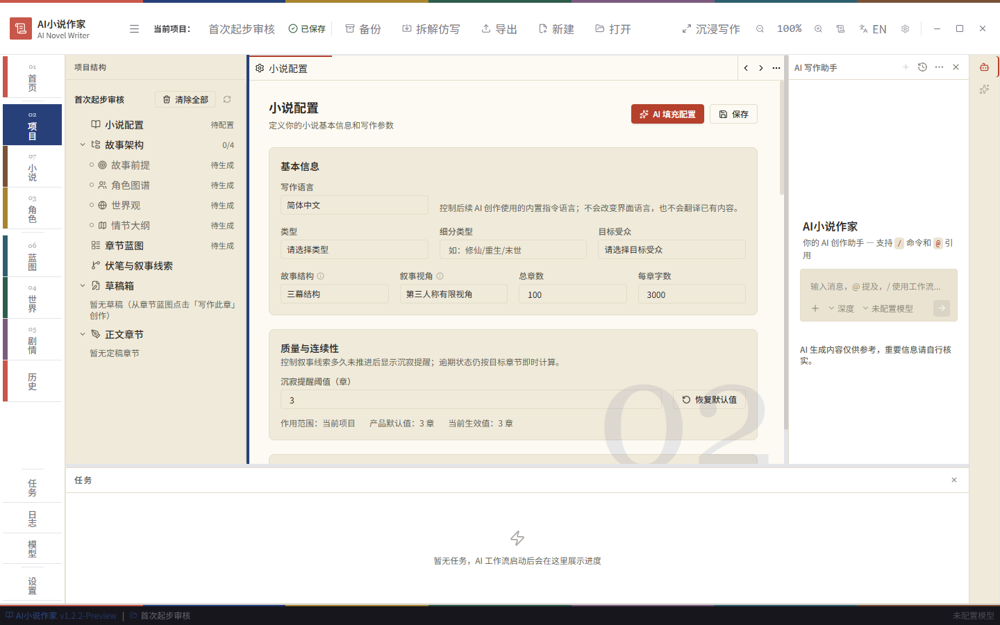
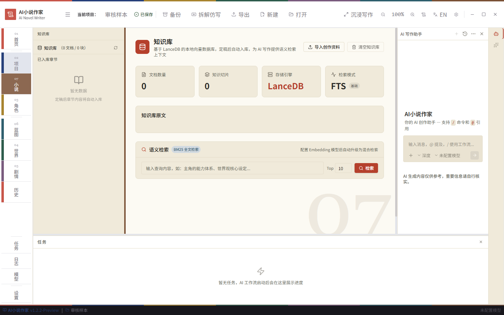
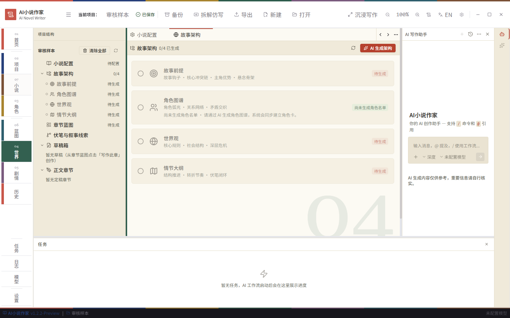
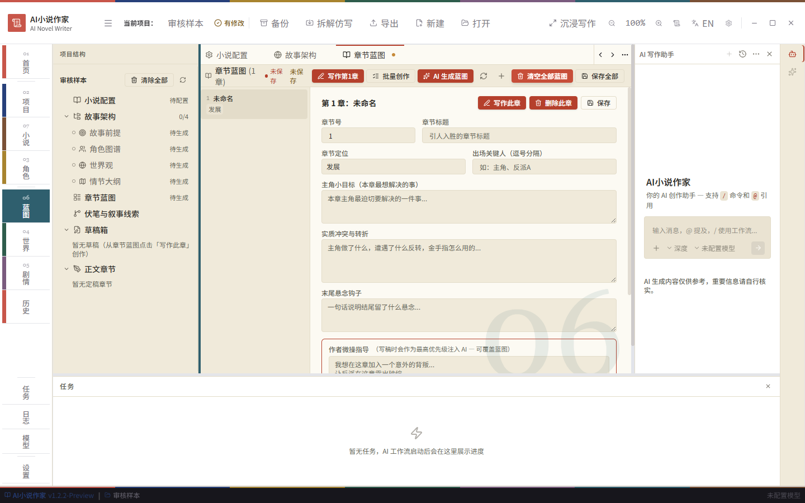
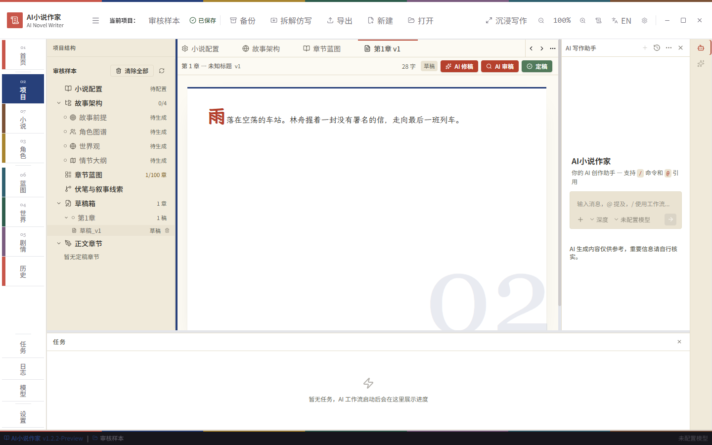
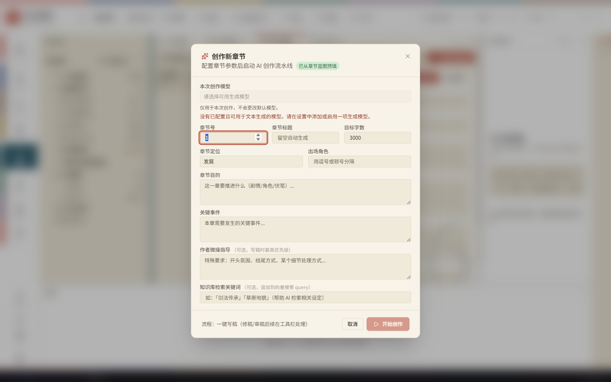
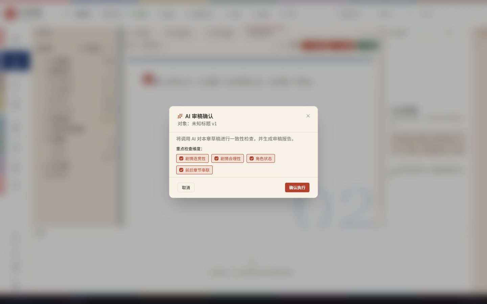
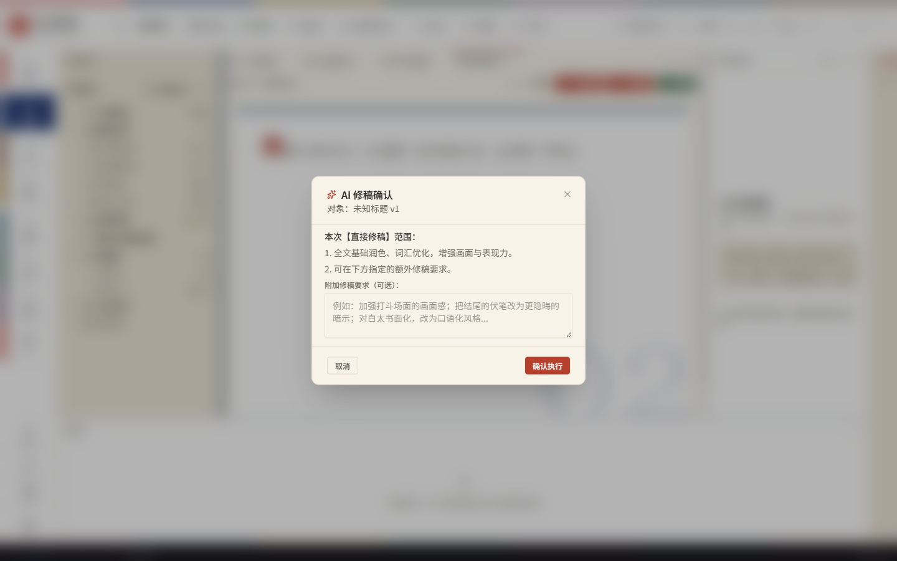
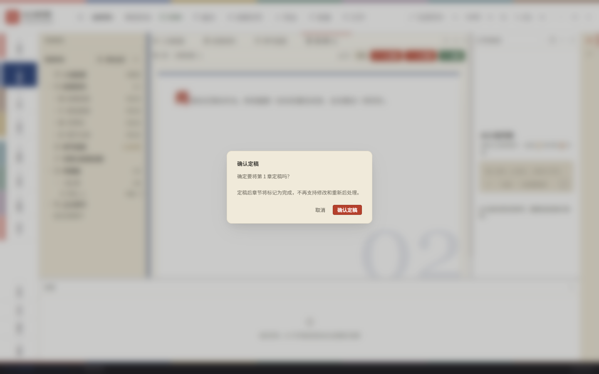

# AI Novel Writer 1.2.2 Preview 用户体验问题报告

本报告供后续 agent 接手时阅读。目标是记录影响上手和完成小说创作的问题。仅描述问题，不包含修改建议或实施方案。

## 审核范围

- 日期：2026-10-11。
- 版本：1.2.2-Preview。
- 仓库：`EthanYoQ/AI-Novel-Writer`。
- 审核提交：`b95489541e006f4e06241cbfaffb3cc7098a4c26`，当时 GitHub 云端安装包构建使用的提交。
- 环境：从该提交构建的独立 Electron 实例，1440 × 900 视口；使用隔离配置和临时小说数据。
- 证据：本次实测截图，使用相对路径随文档附带，不依赖原机器的临时缓存。

实测覆盖新建项目、小说配置、故事架构、章节蓝图、写作弹窗，以及草稿的审稿、修稿、定稿确认界面。草稿正文为预置样本；没有调用模型，也没有执行定稿。因此，本报告不评价生成结果、审稿报告生成后的完整流程、修稿执行结果或安装包行为。

## 已确认的问题

| 编号 | 问题 | 实际表现与使用影响 | 证据 |
|---|---|---|---|
| UX-01 | 导航不能表达创作顺序 | 左栏编号依次为 01、02、07、03、06、04、05，混合项目、资料和创作功能。用户无法按排列判断先做什么、下一步去哪。 | 图 1 |
| UX-02 | 入口名称与页面内容不一致 | “小说”打开知识库；“世界”打开包含角色图谱、情节大纲等内容的故事架构。落地页与入口名称表达的范围不同。 | 图 2、图 3 |
| UX-03 | 起步时需要判断太多事项 | 新建后直接进入长配置表。故事结构、叙事视角、连续性阈值等同时出现；“沉寂提醒阈值”排在核心大纲之前。当前必做与以后再处理的内容不够清楚。 | 图 1 |
| UX-04 | 后续章节操作依赖找到具体草稿版本 | 审稿、修稿、定稿按钮在草稿页顶部可见，但入口位于“项目→草稿箱→章节→具体版本”。停留在蓝图等页面时，用户看不到同样的操作入口。 | 图 4、图 5 |
| UX-05 | 写作前重复呈现章节配置 | 蓝图已有章节号、标题、角色、定位和作者指导；点击“写作此章”后，这些信息又出现在大表单中。虽然支持预填，用户仍需再次判断和检查参数。 | 图 4、图 6 |
| UX-06 | 默认布局分散注意力并挤压主要内容 | 项目树、编辑区、AI 助手和任务面板同时展开。没有对话和任务时，空面板仍占明显空间，配置和正文只能在较小区域查看、滚动。 | 图 1、图 5 |
| UX-07 | 技术术语增加理解负担 | 创作页面直接展示 LanceDB、FTS、BM25、Embedding、向量搜索 query 等概念。用户需要理解实现术语，才能判断这些功能与写小说的关系。 | 图 2、图 6 |

UX-04 的准确含义是操作入口依赖草稿上下文，不是三个按钮在草稿页内仍被折叠隐藏。UX-05 是重复呈现与检查，不是要求用户把全部信息重新填写。

## 截图证据

### 图 1 新建项目后的默认页面

支持 UX-01、UX-03、UX-06。左栏编号顺序、配置首屏和空助手、任务面板同时可见。

### 图 2 小说入口实际打开知识库

支持 UX-02、UX-07。左栏选中“小说”，中心显示“知识库”及数据库、检索术语。

### 图 3 世界入口实际打开故事架构

支持 UX-02。页面包含故事前提、角色图谱、世界观和情节大纲。

### 图 4 章节蓝图与章节参数

支持 UX-04、UX-05。写作入口位于蓝图页；章节参数在这里编辑。

### 图 5 具体草稿版本的操作入口

支持 UX-04、UX-06。草稿箱中的版本打开后，顶部显示“AI 修稿”“AI 审稿”“定稿”。正文是预置审核样本，不是模型生成结果。

### 图 6 点击写作此章后的配置弹窗

支持 UX-05、UX-07。弹窗标注“已从章节蓝图预填”，再次展示章节参数，并出现“向量搜索 query”等术语。

## 操作边界补充截图

以下截图记录实测到达的位置，不新增问题结论。三项操作均停在确认阶段。

## 证据说明

文件选择器在测试中返回临时目录；草稿通过临时数据库预置。测试副本单独使用匹配 Electron 的 SQLite 原生依赖，未修改产品源码和原工作树依赖。本地依赖不匹配不属于上述产品问题。

本文问题限定于上述提交和实测状态，不代表后续版本仍然存在，也不代表必须逐项点击全部左栏才能完成创作。

设计感与功能冗余补充报告见 [`design-redundancy.md`](design-redundancy.md)，编号从 UX-08 起。

隐藏 AI 聊天入口的需求记录见 [`req-hide-ai-chat.md`](req-hide-ai-chat.md)。
